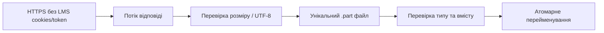

# LMS CLI

Окремий навчальний read-only клієнт LMS Robot Dreams. Доступні `login`,
`login --check`, локальний `logout`, `lessons`, `homework` і `materials`.
Sync і відео поки повертають `NOT_IMPLEMENTED` (exit 3).

## Встановлення зі свіжого клону

Node.js **24 LTS** (`engines` та `.nvmrc`), pnpm **10.33.2** (`packageManager`).
Node.js 24 має статус LTS: [офіційні релізи](https://nodejs.org/en/about/previous-releases).
TypeScript 5.9.3 збігається з версією проєкту; пакет має власний lockfile.
Встанови зазначену версію pnpm своїм менеджером пакунків/Corepack.

З кореня репозиторію:

```sh
cd tools/lms-client
nvm use  # якщо користуєшся nvm
pnpm install --frozen-lockfile
pnpm run build
pnpm --silent run lms --help
pnpm test
```

Кореневі залежності Nest для клієнта не потрібні. `tsc` компілює `src/` у
власний `dist/`; CLI запускає скомпільований JS. Після зміни TypeScript
повтори `pnpm run build`.

## Контракт команд

Виклики нижче визначають інтерфейс команд. Вхід, лекції, домашки та матеріали
реалізовані; sync/video належать наступним пунктам плану.

| Команда | Призначення й аргументи |
| --- | --- |
| `login` | Інтерактивний вхід; пароль не приймається в аргументах |
| `login --check` | Без пароля: примусовий refresh і перевірка читання курсу 5467 |
| `logout` | Очищення локальної сесії |
| `lessons [--course <id>]` | Усі лекції курсу |
| `homework <selector> [--course <id>]` | Умова домашки |
| `materials <selector> [--course <id>] [--download]` | Перелік матеріалів; явне завантаження підтриманих файлів |
| `sync <selector> [--course <id>] [--video]` | Локальний текстовий контекст; відео за явним прапорцем |
| `video <selector> [--course <id>]` | Явне завантаження відео |

`<selector>` — рівно один із `--lesson <number>`, `--lesson-id <id>`, `--latest`.
`latest` означає останню опубліковану доступну лекцію за датою заняття.
Селектори взаємовиключні, щоб виклик не мав двозначного трактування.

`video` та `sync --video` також приймають `--quality <height>` і
`--media-id <id>` для вибору запису. Курс за замовчуванням **5467**, якість
**1080**. Усі числові аргументи — додатні безпечні цілі числа; якість задається
числом (`720`, `1080`), без `p`. Реально доступні якості перевірятимемо за LMS
у пункті 5. Позиційні параметри, невідомі/повторні опції та опції іншої
команди відхиляються. Підтримуються `--course=5467`, `--help`, `-h`, `help`.

```sh
pnpm --silent run lms homework --help
pnpm --silent run lms homework --lesson 13
pnpm --silent run lms sync --lesson-id 104319
pnpm --silent run lms video --lesson 13 --quality 1080 --media-id 140777
```

## Вивід і коди завершення

stdout — один JSON-об'єкт на рядок. `--silent` вимикає службовий банер pnpm,
щоб агент міг парсити stdout. stderr — повідомлення для людини й майбутній
прогрес; його не потрібно парсити як JSON.

```json
{"ok":true,"data":{"usage":"lms <command> [options]"}}
```

Це скорочений приклад довідки. Помилка має стабільну форму:

```json
{"ok":false,"error":{"code":"NOT_IMPLEMENTED","message":"…"}}
```

| Exit | Код | Значення |
| --- | --- | --- |
| 0 | — | Успіх, включно з довідкою та викликом без аргументів |
| 1 | `INTERNAL_ERROR` | Неочікувана внутрішня помилка |
| 2 | `INVALID_ARGUMENTS`, `LESSON_NOT_FOUND`, `LESSON_AMBIGUOUS` | Некоректний виклик або неоднозначний/відсутній урок |
| 3 | `NOT_IMPLEMENTED` | Аргументи валідні, але дія ще не реалізована |
| 4 | `AUTH_REQUIRED`, `LOGIN_FAILED`, `INTERACTIVE_REQUIRED`, `AUTH_INTERACTION_REQUIRED`, `SESSION_INVALID` | Потрібен login, інтерактивний термінал або перевірка сесії |
| 5 | `NETWORK_ERROR`, `HTTP_ERROR`, `API_RESPONSE_INVALID`, `GRAPHQL_ERROR`, `LESSON_UNAVAILABLE` | Мережа чи неочікувана відповідь LMS |
| 6 | `SESSION_BUSY` | Сесія зайнята або втрачено блокування |
| 130 | `CANCELLED` | Вхід скасовано через Ctrl+C/Ctrl+D |

`SESSION_IO` має exit 1. Сирі аргументи, серверні error bodies, токени й cookies
не віддзеркалюємо в помилках, щоб секрети не опинилися у виводі.

Парсер використовує вбудований [Node.js `util.parseArgs`](https://nodejs.org/api/util.html#utilparseargsconfig).
Він розбирає рядки аргументів; наша перевірка додатково контролює числа,
сумісність опцій і вибір лекції. Commander був би зручним для великого CLI,
але для парсера зараз додаткова runtime-залежність не потрібна.

## Вхід і перевірка сесії

```sh
pnpm --silent run lms login
# Email і пароль вводяться в терміналі; пароль не відображається.
# Перший процес завершується. Наступний виклик — новий процес:
pnpm --silent run lms login --check
pnpm --silent run lms logout
```

`login` потребує TTY на stdin і stderr; пароль через аргументи, env або pipe
не приймається. Ctrl+C/Ctrl+D скасовують ввід. Login повертає лише `expiresAt`.
`login --check` не питає пароль: завжди оновлює токен через cookie jar,
читає ID та перекладену назву курсу 5467 і повертає їх із `expiresAt`.
Це мінімальна перевірка авторизації, а не реалізація переліку лекцій.
GraphQL очікує ID курсу у форматі `/api/courses/5467`, а не лише `5467`.

REST: `https://lms.robotdreams.cc/api/login` і `/api/token/refresh`.
Login використовує JSON `email`, `password`, `_remember_me: true` та
параметр `_remember_me_=true`, який використовує frontend LMS.
Токен береться з `access_token` і використовується як непрозорий рядок.
Строк дії береться з `expires_in_seconds`: попри назву, frontend LMS
трактує його як абсолютний Unix timestamp у секундах. Множимо на 1000
і зберігаємо в `expiresAt` для планування оновлення.
GraphQL: `https://lms.academius.io/api/graphql`, Bearer token.
Авторизацію перевіряє LMS; локальний строк дії лише планує refresh.

Перед читанням прострочений токен або токен із залишком ≤60 секунд оновлюється.
Після HTTP 401 виконується один refresh і один повтор читання; повторний 401
або відмова refresh очищають недійсну локальну сесію та просять login.
Передчасний refresh і refresh після 401 — окремі кроки; циклів немає.
Мережеві помилки/5xx не видаляють останню збережену сесію. Запит має timeout
15 секунд. Перенаправлення не виконуються автоматично; якщо LMS потребує
додаткової браузерної перевірки, повертається явна помилка, без обходу.

Сесія: `~/.local/share/retro-games-rental/lms-client/session.json`.
Версія формату, access token, строк його дії в мілісекундах і serialized cookie
jar; email та пароль не зберігаються. Каталог — `0700`, файл — `0600`.
Це обмеження доступу, не шифрування. Logout видаляє лише локальний файл,
без припущень про серверний logout; повторний logout теж успішний.

Для ізольованих перевірок можна задати `LMS_SESSION_DIR`: абсолютний шлях
поза репозиторієм. Не спрямовуй його на каталог загального призначення:
клієнт виставляє цьому каталогу `0700`. Символічне посилання замість каталогу
або файла сесії не читається.

[tough-cookie](https://github.com/salesforce/tough-cookie) обирає cookies за
доменом, шляхом, Secure і строком дії; jar зберігається між процесами.
[proper-lockfile](https://github.com/moxystudio/node-proper-lockfile) серіалізує
читання → refresh → запис і logout між процесами. Lock оновлюється кожні
5 секунд; після аварійного завершення стає stale через 30 секунд. Очікування
обмежене приблизно 40 секундами. Не видаляй активний lock вручну.
Оновлення сесії: тимчасовий файл `0600` → fsync → атомарний rename.
За SIGKILL може залишитися приватний `.session-*.tmp`; він не використовується
як сесія й міститься в тому самому каталозі поза git.

Тести перевіряють login/refresh/read на локальному HTTP-сервері, новий процес,
паралельні процеси, права, відмови й cookie rules. Реальний login, refresh і
читання курсу підтверджені 2026-10-12; секрети не потрапляють у тестові fixtures.

## Лекції та домашки

```sh
pnpm --silent run lms lessons
pnpm --silent run lms homework --lesson 13
pnpm --silent run lms homework --lesson-id 104318
pnpm --silent run lms homework --latest
```

`lessons` повертає `{courseId, lessons, fetchedAt}`. Для кожного уроку є
числовий `id`, GraphQL `iri`, `number` (позиція LMS), назва, дата `startsAt`,
`hidden`, `accessStatus`, `available`, `translationStatus` і URL.
Забираються всі сторінки: LMS обмежує сторінку 30 записами, навіть якщо
попросити більше. Повторені ID, порушена структура, зміна totalCount
під час читання чи зациклена пагінація дають `API_RESPONSE_INVALID`.
Можна повторити команду, якщо дані курсу змінилися під час читання.

`--lesson` — номер із поля position LMS, а не індекс у завантаженому масиві.
У курсу є додаткове заняття з номером 0; його можна вибрати через `--lesson-id`.
Однакові номери потребують `--lesson-id`. ID уроку перевіряється серед уроків
вибраного курсу. Приховані уроки, статуси unavailable/live та відсутній статус
не вважаються доступними. `--latest` додатково відкидає майбутні/відсутні дати
і вибирає найбільшу дату заняття. Це не пошук невиконаної домашки.

`homework` повертає `{courseId, lesson, status, homeworks, fetchedAt}`.
Домашки знаходяться через `lesson.homeworks`, включно з cursor-пагінацією;
їхні ID не виводяться з номера уроку. Якщо домашок немає, exit 0,
`status: "no_homework"` і порожній масив. Якщо є — `status: "available"`.
Кожна має `id`, `iri`, `name`, `url`, `translationStatus`, `descriptionRaw`,
`html`, `markdown` і `warnings`.

Обираємо український переклад. Якщо його немає або він позначений empty,
`translationStatus: "missing"`, назва й тексти — null. Переклад не вигадується.
`descriptionRaw` зберігає вихідний рядок LMS без змін: це може бути HTML або
JSON-масив блоків. `html` об'єднує вміст text-блоків; `markdown` перетворює
його через [Turndown](https://github.com/mixmark-io/turndown) та
[GFM-плагін](https://github.com/mixmark-io/turndown-plugin-gfm) для таблиць.
Збережено посилання, списки й код. Невідомі типи блоків залишаються у
`descriptionRaw` і дають `UNSUPPORTED_DESCRIPTION_BLOCK` у warnings;
HTML/Markdown тоді містять лише підтримані текстові блоки. Некоректний JSON
опису завершується явною помилкою. Оригінальний HTML є джерелом істини:
Markdown може спрощувати оформлення. Скрипти не виконуються, зовнішні
посилання не завантажуються; HTML повертається як дані, не для вставки в DOM.

Кожен запит використовує спільну авторизацію з refresh і максимум одним
повтором після 401. GraphQL errors обробляються навіть при HTTP 200,
частковий data з errors не видається за успіх. Запити не читають оцінки,
студентські відповіді чи коментарі й не змінюють статусів у LMS.

Перевірено на реальній LMS 2026-10-12: усі 36 занять; домашки лекцій 13 та 12;
`--latest` вибрав доступну лекцію 22. Це результати на дату перевірки.

## Матеріали та транскрипції

```sh
# Лише перелік: без створення локальних файлів
pnpm --silent run lms materials --lesson 13
# Завантажити файли й записати materials-manifest.json
pnpm --silent run lms materials --lesson 13 --download
```

Підтримуються ті самі `--lesson`, `--lesson-id`, `--latest`, `--course`.
`--download` дозволений лише для materials. Отримуємо всі сторінки матеріалів,
типів і субтитрів. Назви й описи — український переклад або явний missing.
Посилання беруться як із link, так і з file/text-блоків description.
У фактичній LMS поле LessonMaterial._id дає помилку, тому числовий ID
виділяється з перевіреного `/api/lesson_materials/<id>`.

Результат містить `materials`, `subtitles`, `transcriptStatus`, `fetchedAt`,
`directory`, `manifestPath`, дані курсу й уроку. Матеріал має `id`, `iri`,
`relationId`, `position`, `type`, `typeName`, назву, опис і `sources`.
Для кожного source зберігаються стабільний URL, kind, role, status і локальний
file, якщо він завантажився. Статуси: `link`, `unsupported`, `not_downloaded`,
`downloaded`, `unavailable`, `failed`; у помилки є безпечний errorCode.
Помилка одного файла не приховує решту матеріалів: перевіряй ці статуси,
навіть якщо команда завершилася з exit 0.

| Джерело | Обробка з --download |
| --- | --- |
| Google Slides | Експорт у PDF, перевірка MIME і сигнатури `%PDF-` |
| Drive, назва містить транскрипцію/transcript/субтитри | Download як UTF-8 текст; оригінал збережено в `.md` |
| Інші Drive-файли | Завантаження в `.bin`, MIME доступний у manifest |
| Прямий PDF / MD / TXT / ZIP / DOCX / PPTX | Завантаження; текст і PDF додатково перевіряються |
| VTT матеріалу або запису лекції | Оригінал `.vtt` і `.txt` з таймкодами |
| GitHub, статті, інші вебсторінки | Стабільне посилання, status link |
| Непідтриманий Google Docs/Drive URL або HTTP-файл | Посилання, status unsupported |

VTT-парсер прибирає cue markup, декодує entities, відкидає дублікати cues
і повторений префікс перекривних rolling cues. Однакові репліки в різний час
зберігаються. Оригінальний VTT не змінюється. Якщо транскрипції взагалі
немає — `transcriptStatus: "missing"`; якщо є джерело, але завантаження
не вдалося — `unavailable`; хоча б одна локальна транскрипція — `available`.
Без --download наявне джерело має статус `not_downloaded`.

Файли зберігаються в
`course-materials/<безпечна-назва-курсу>--<id>/<безпечна-назва-уроку>--<id>/`.
Назви файлів будуються зі стабільних material/media ID, а не з filename
сервера. Перевіряються компоненти шляху й символічні посилання. Структура
зі стабільними ID усуває колізії однакових назв; обробка перейменувань
і повний manifest.json для sync належать пункту 6.



Таймаут 30 секунд охоплює запит і потік; максимум 5 перенаправлень,
усі через HTTPS. Ліміт тексту/VTT — 10 МБ, інших файлів — 100 МБ.
Content-Length перевіряється, якщо відповідь не стиснена. HTML/XML/JSON
сторінка входу чи помилки не зберігається як успішний файл. Немає cookie jar
Google або передачі LMS Bearer зовнішнім хостам. Ctrl+C скасовує завантаження,
прибирає поточний .part і дає CANCELLED/exit130. Поточний GraphQL-запит
може завершитися перед обробкою скасування. Повторів і resume поки немає;
повторний --download завантажує файли заново. При помилці перевірки
попередній завершений файл зберігається.

Тимчасові URL з підписами існують лише в пам'яті під час завантаження.
У JSON-виводі, materials-manifest.json і описах URL очищені від query/hash;
для Drive збережено канонічний `/file/d/<id>/view`. Через це descriptionRaw
матеріалу може відрізнятися від відповіді LMS лише очищенням URL/JSON-серіалізацією.
Повний актуальний URL завжди заново читається з LMS. Не передавай очищений
URL VTT в download напряму: підпис для нього потрібно отримати з LMS.

Реально перевірено 2026-10-12: урок 13 має 3 матеріали; Slides віддав PDF
1 705 270 байтів, Drive — Markdown 135 744 байти, 421 репліка з таймкодами.
GitHub залишився посиланням. VTT CloudFront повернув 403 і позначений
unavailable; локальна транскрипція доступна з Drive. Працездатність VTT
перетворення перевірено offline fixtures, а не успішним живим download.

## Локальні файли й незалежність від сервера

Корінь завантажень — `course-materials/` у корені репозиторію,
незалежно від робочої теки процесу. Шлях обчислюється від розташування
модуля, без створення каталогу. Структуру з назвами курсів/лекцій і manifest
реалізуємо у відповідних пунктах.

`course-materials/`, вкладені `dist/` та `node_modules/` виключені з git.
`tools/lms-client` виключено з базового та build-конфігів TypeScript Nest.
Клієнт не імпортує серверний код, не читає його `.env` і не підключає БД.

`pnpm test` збирає пакет і перевіряє реальний процес CLI: stdout/stderr,
exit codes, команди, неправильні аргументи, дефолти й запуск з іншої теки.

ESLint для клієнта запускається з кореня репозиторію: `pnpm run lint:lms`.
TypeScript-код перевіряється з типами; `.mjs`-тести — звичайними JS-правилами.
