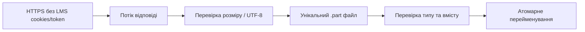
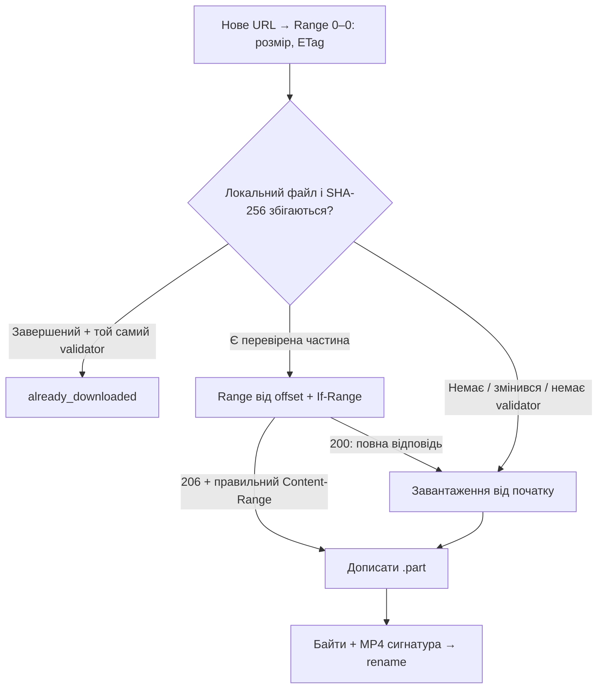

# LMS CLI

Окремий навчальний read-only клієнт LMS Robot Dreams. Доступні `login`,
`login --check`, локальний `logout`, `lessons`, `homework`, `materials`, `video` і `sync`.

## Встановлення зі свіжого клону

Node.js **24 LTS** (`engines` та `.nvmrc`), pnpm **10.33.2** (`packageManager`).
Node.js 24 має статус LTS: [офіційні релізи](https://nodejs.org/en/about/previous-releases).
TypeScript 5.9.3 збігається з версією проєкту; пакет має власний lockfile.
Встанови зазначену версію pnpm своїм менеджером пакунків/Corepack.

З кореня репозиторію:

```sh
cd tools/lms-client
nvm use  # якщо користуєшся nvm
pnpm install --frozen-lockfile
pnpm run build
pnpm --silent run lms --help
pnpm test
```

Кореневі залежності Nest для клієнта не потрібні. `tsc` компілює `src/` у
власний `dist/`; CLI запускає скомпільований JS. Після зміни TypeScript
повтори `pnpm run build`.

## Контракт команд

Виклики нижче визначають інтерфейс команд. Усі команди
нижче реалізовані; sync об’єднує отримання навчального контексту.

| Команда                                                                   | Призначення й аргументи                                       |
| ------------------------------------------------------------------------- | ------------------------------------------------------------- |
| `login`                                                                   | Інтерактивний вхід; пароль не приймається в аргументах        |
| `login --check`                                                           | Без пароля: примусовий refresh і перевірка читання курсу 5467 |
| `logout`                                                                  | Очищення локальної сесії                                      |
| `lessons [--course <id>]`                                                 | Усі лекції курсу                                              |
| `homework <selector> [--course <id>]`                                     | Умова домашки                                                 |
| `materials <selector> [--course <id>] [--download]`                       | Перелік матеріалів; явне завантаження підтриманих файлів      |
| `sync <selector> [--course <id>] [--video]`                               | Локальний текстовий контекст; відео за явним прапорцем        |
| `video <selector> [--course <id>] [--quality <height>] [--media-id <id>]` | Явне завантаження відео                                       |

`<selector>` — рівно один із `--lesson <number>`, `--lesson-id <id>`, `--latest`.
`latest` означає останню опубліковану доступну лекцію за датою заняття.
Селектори взаємовиключні, щоб виклик не мав двозначного трактування.

`video` та `sync --video` також приймають `--quality <height>` і
`--media-id <id>` для вибору запису. Курс за замовчуванням **5467**, якість
**1080**. Усі числові аргументи — додатні безпечні цілі числа; якість задається
числом (`720`, `1080`), без `p`. Реально доступні якості перевіряються за LMS. Позиційні параметри, невідомі/повторні опції та опції іншої
команди відхиляються. Підтримуються `--course=5467`, `--help`, `-h`, `help`.

```sh
pnpm --silent run lms homework --help
pnpm --silent run lms homework --lesson 13
pnpm --silent run lms sync --lesson-id 104319
pnpm --silent run lms video --lesson 13 --quality 1080 --media-id 140777
```

## Вивід і коди завершення

stdout — один JSON-об'єкт на рядок. `--silent` вимикає службовий банер pnpm,
щоб агент міг парсити stdout. stderr — повідомлення для людини й майбутній
прогрес; його не потрібно парсити як JSON.

```json
{ "ok": true, "data": { "usage": "lms <command> [options]" } }
```

Це скорочений приклад довідки. Помилка має стабільну форму:

```json
{ "ok": false, "error": { "code": "NOT_IMPLEMENTED", "message": "…" } }
```

| Exit | Код                                                                                                     | Значення                                                   |
| ---- | ------------------------------------------------------------------------------------------------------- | ---------------------------------------------------------- |
| 0    | —                                                                                                       | Успіх, включно з довідкою та викликом без аргументів       |
| 1    | `INTERNAL_ERROR`                                                                                        | Неочікувана внутрішня помилка                              |
| 2    | `INVALID_ARGUMENTS`, `LESSON_NOT_FOUND`, `LESSON_AMBIGUOUS`                                             | Некоректний виклик або неоднозначний/відсутній урок        |
| 3    | `NOT_IMPLEMENTED`                                                                                       | Аргументи валідні, але дія ще не реалізована               |
| 4    | `AUTH_REQUIRED`, `LOGIN_FAILED`, `INTERACTIVE_REQUIRED`, `AUTH_INTERACTION_REQUIRED`, `SESSION_INVALID` | Потрібен login, інтерактивний термінал або перевірка сесії |
| 5    | `NETWORK_ERROR`, `HTTP_ERROR`, `API_RESPONSE_INVALID`, `GRAPHQL_ERROR`, `LESSON_UNAVAILABLE`            | Мережа чи неочікувана відповідь LMS                        |
| 6    | `SESSION_BUSY`, `VIDEO_BUSY`, `SYNC_BUSY`, `SYNC_DIRECTORY_AMBIGUOUS`                                   | Сесія/відеофайл зайняті або втрачено блокування            |
| 130  | `CANCELLED`                                                                                             | Ввід або завантаження скасовано                            |

`SESSION_IO` має exit 1. Сирі аргументи, серверні error bodies, токени й cookies
не віддзеркалюємо в помилках, щоб секрети не опинилися у виводі.

Парсер використовує вбудований [Node.js `util.parseArgs`](https://nodejs.org/api/util.html#utilparseargsconfig).
Він розбирає рядки аргументів; наша перевірка додатково контролює числа,
сумісність опцій і вибір лекції. Commander був би зручним для великого CLI,
але для парсера зараз додаткова runtime-залежність не потрібна.

## Вхід і перевірка сесії

```sh
pnpm --silent run lms login
# Email і пароль вводяться в терміналі; пароль не відображається.
# Перший процес завершується. Наступний виклик — новий процес:
pnpm --silent run lms login --check
pnpm --silent run lms logout
```

`login` потребує TTY на stdin і stderr; пароль через аргументи, env або pipe
не приймається. Ctrl+C/Ctrl+D скасовують ввід. Login повертає лише `expiresAt`.
`login --check` не питає пароль: завжди оновлює токен через cookie jar,
читає ID та перекладену назву курсу 5467 і повертає їх із `expiresAt`.
Це мінімальна перевірка авторизації, а не реалізація переліку лекцій.
GraphQL очікує ID курсу у форматі `/api/courses/5467`, а не лише `5467`.

REST: `https://lms.robotdreams.cc/api/login` і `/api/token/refresh`.
Login використовує JSON `email`, `password`, `_remember_me: true` та
параметр `_remember_me_=true`, який використовує frontend LMS.
Токен береться з `access_token` і використовується як непрозорий рядок.
Строк дії береться з `expires_in_seconds`: попри назву, frontend LMS
трактує його як абсолютний Unix timestamp у секундах. Множимо на 1000
і зберігаємо в `expiresAt` для планування оновлення.
GraphQL: `https://lms.academius.io/api/graphql`, Bearer token.
Авторизацію перевіряє LMS; локальний строк дії лише планує refresh.

Перед читанням прострочений токен або токен із залишком ≤60 секунд оновлюється.
Після HTTP 401 виконується один refresh і один повтор читання; повторний 401
або відмова refresh очищають недійсну локальну сесію та просять login.
Передчасний refresh і refresh після 401 — окремі кроки; циклів немає.
Мережеві помилки/5xx не видаляють останню збережену сесію. Запит має timeout
15 секунд. Перенаправлення не виконуються автоматично; якщо LMS потребує
додаткової браузерної перевірки, повертається явна помилка, без обходу.

Сесія: `~/.local/share/retro-games-rental/lms-client/session.json`.
Версія формату, access token, строк його дії в мілісекундах і serialized cookie
jar; email та пароль не зберігаються. Каталог — `0700`, файл — `0600`.
Це обмеження доступу, не шифрування. Logout видаляє лише локальний файл,
без припущень про серверний logout; повторний logout теж успішний.

Для ізольованих перевірок можна задати `LMS_SESSION_DIR`: абсолютний шлях
поза репозиторієм. Не спрямовуй його на каталог загального призначення:
клієнт виставляє цьому каталогу `0700`. Символічне посилання замість каталогу
або файла сесії не читається.

[tough-cookie](https://github.com/salesforce/tough-cookie) обирає cookies за
доменом, шляхом, Secure і строком дії; jar зберігається між процесами.
[proper-lockfile](https://github.com/moxystudio/node-proper-lockfile) серіалізує
читання → refresh → запис і logout між процесами. Lock оновлюється кожні
5 секунд; після аварійного завершення стає stale через 30 секунд. Очікування
обмежене приблизно 40 секундами. Не видаляй активний lock вручну.
Оновлення сесії: тимчасовий файл `0600` → fsync → атомарний rename.
За SIGKILL може залишитися приватний `.session-*.tmp`; він не використовується
як сесія й міститься в тому самому каталозі поза git.

Тести перевіряють login/refresh/read на локальному HTTP-сервері, новий процес,
паралельні процеси, права, відмови й cookie rules. Реальний login, refresh і
читання курсу підтверджені 2026-10-12; секрети не потрапляють у тестові fixtures.

## Лекції та домашки

```sh
pnpm --silent run lms lessons
pnpm --silent run lms homework --lesson 13
pnpm --silent run lms homework --lesson-id 104318
pnpm --silent run lms homework --latest
```

`lessons` повертає `{courseId, lessons, fetchedAt}`. Для кожного уроку є
числовий `id`, GraphQL `iri`, `number` (позиція LMS), назва, дата `startsAt`,
`hidden`, `accessStatus`, `available`, `translationStatus` і URL.
Забираються всі сторінки: LMS обмежує сторінку 30 записами, навіть якщо
попросити більше. Повторені ID, порушена структура, зміна totalCount
під час читання чи зациклена пагінація дають `API_RESPONSE_INVALID`.
Можна повторити команду, якщо дані курсу змінилися під час читання.

`--lesson` — номер із поля position LMS, а не індекс у завантаженому масиві.
У курсу є додаткове заняття з номером 0; його можна вибрати через `--lesson-id`.
Однакові номери потребують `--lesson-id`. ID уроку перевіряється серед уроків
вибраного курсу. Приховані уроки, статуси unavailable/live та відсутній статус
не вважаються доступними. `--latest` додатково відкидає майбутні/відсутні дати
і вибирає найбільшу дату заняття. Це не пошук невиконаної домашки.

`homework` повертає `{courseId, lesson, status, homeworks, fetchedAt}`.
Домашки знаходяться через `lesson.homeworks`, включно з cursor-пагінацією;
їхні ID не виводяться з номера уроку. Якщо домашок немає, exit 0,
`status: "no_homework"` і порожній масив. Якщо є — `status: "available"`.
Кожна має `id`, `iri`, `name`, `url`, `translationStatus`, `descriptionRaw`,
`html`, `markdown` і `warnings`.

Обираємо український переклад. Якщо його немає або він позначений empty,
`translationStatus: "missing"`, назва й тексти — null. Переклад не вигадується.
`descriptionRaw` зберігає вихідний рядок LMS без змін: це може бути HTML або
JSON-масив блоків. `html` об'єднує вміст text-блоків; `markdown` перетворює
його через [Turndown](https://github.com/mixmark-io/turndown) та
[GFM-плагін](https://github.com/mixmark-io/turndown-plugin-gfm) для таблиць.
Збережено посилання, списки й код. Невідомі типи блоків залишаються у
`descriptionRaw` і дають `UNSUPPORTED_DESCRIPTION_BLOCK` у warnings;
HTML/Markdown тоді містять лише підтримані текстові блоки. Некоректний JSON
опису завершується явною помилкою. Оригінальний HTML є джерелом істини:
Markdown може спрощувати оформлення. Скрипти не виконуються, зовнішні
посилання не завантажуються; HTML повертається як дані, не для вставки в DOM.

Кожен запит використовує спільну авторизацію з refresh і максимум одним
повтором після 401. GraphQL errors обробляються навіть при HTTP 200,
частковий data з errors не видається за успіх. Запити не читають оцінки,
студентські відповіді чи коментарі й не змінюють статусів у LMS.

Перевірено на реальній LMS 2026-10-12: усі 36 занять; домашки лекцій 13 та 12;
`--latest` вибрав доступну лекцію 22. Це результати на дату перевірки.

## Матеріали та транскрипції

```sh
# Лише перелік: без створення локальних файлів
pnpm --silent run lms materials --lesson 13
# Завантажити файли й записати materials-manifest.json
pnpm --silent run lms materials --lesson 13 --download
```

Підтримуються ті самі `--lesson`, `--lesson-id`, `--latest`, `--course`.
`--download` дозволений лише для materials. Отримуємо всі сторінки матеріалів,
типів і субтитрів. Назви й описи — український переклад або явний missing.
Посилання беруться як із link, так і з file/text-блоків description.
У фактичній LMS поле LessonMaterial._id дає помилку, тому числовий ID
виділяється з перевіреного `/api/lesson_materials/<id>`.

Результат містить `materials`, `subtitles`, `transcriptStatus`, `fetchedAt`,
`directory`, `manifestPath`, дані курсу й уроку. Матеріал має `id`, `iri`,
`relationId`, `position`, `type`, `typeName`, назву, опис і `sources`.
Для кожного source зберігаються стабільний URL, kind, role, status і локальний
file, якщо він завантажився. Статуси: `link`, `unsupported`, `not_downloaded`,
`downloaded`, `unavailable`, `failed`; у помилки є безпечний errorCode.
Помилка одного файла не приховує решту матеріалів: перевіряй ці статуси,
навіть якщо команда завершилася з exit 0.

| Джерело                                               | Обробка з --download                                |
| ----------------------------------------------------- | --------------------------------------------------- |
| Google Slides                                         | Експорт у PDF, перевірка MIME і сигнатури `%PDF-`   |
| Drive, назва містить транскрипцію/transcript/субтитри | Download як UTF-8 текст; оригінал збережено в `.md` |
| Інші Drive-файли                                      | Завантаження в `.bin`, MIME доступний у manifest    |
| Прямий PDF / MD / TXT / ZIP / DOCX / PPTX             | Завантаження; текст і PDF додатково перевіряються   |
| VTT матеріалу або запису лекції                       | Запасне джерело для одного `transcript.md`          |
| GitHub, статті, інші вебсторінки                      | Стабільне посилання, status link                    |
| Непідтриманий Google Docs/Drive URL або HTTP-файл     | Посилання, status unsupported                       |

VTT-парсер прибирає cue markup, декодує entities, відкидає дублікати cues
і повторений префікс перекривних rolling cues. Однакові репліки в різний час
зберігаються. Готова транскрипція з Drive має пріоритет; VTT завантажується лише як запасний
варіант, перетворюється на `transcript.md`, а проміжні файли видаляються.
Якщо транскрипції взагалі
немає — `transcriptStatus: "missing"`; якщо є джерело, але завантаження
не вдалося — `unavailable`; хоча б одна локальна транскрипція — `available`.
Без --download наявне джерело має статус `not_downloaded`.

Файли зберігаються безпосередньо в
`course-materials/<номер>-<безпечна-назва-уроку>/`.
Наприклад: `01-Як-працює-Node-js-…/` та
`14-Transactions-і-SQL-optimization-у-реальних-сценаріях/`.
Цей каталог матеріалів належить одному курсу; інший course ID потребує іншого root.
Номер має мінімум дві цифри для сортування; урок без номера — `без-номера-…`.
Презентація — `presentation.pdf`, транскрипція — `transcript.md`, інші матеріали
називаються за їхніми тайтлами. Однакові назви отримують суфікс `-2`, `-3`.
`additional-materials.md` містить таблицю зовнішніх посилань. Для GitHub-файлів
викладача додається локальне посилання у `reference/node-js-pro`; якщо це
`additional.md`, його HTTP(S)-посилання також потрапляють у таблицю.
Сторінки сторонніх сайтів клієнт автоматично не обходить.

LMS ID зберігаються у manifest і прихованих `.lms/directory-manifest.json`,
а не в назвах папок. Materials, video і sync повторно знаходять теки за ID
навіть після перейменування уроку в LMS. Кілька тек із тим самим ID або
зайнята іншим ID назва дають `SYNC_DIRECTORY_AMBIGUOUS`, без злиття файлів.
Старий проміжний каталог курсу й суфікси LMS ID мігрують автоматично:
файли переносяться, шляхи в manifest оновлюються. Блокування структури й
журнал `.directory-move.json` дозволяють завершити перервану міграцію.



Таймаут 30 секунд охоплює запит і потік; максимум 5 перенаправлень,
усі через HTTPS. Ліміт тексту/VTT — 10 МБ, інших файлів — 100 МБ.
Content-Length перевіряється, якщо відповідь не стиснена. HTML/XML/JSON
сторінка входу чи помилки не зберігається як успішний файл. Немає cookie jar
Google або передачі LMS Bearer зовнішнім хостам. Ctrl+C скасовує завантаження,
прибирає поточний .part і дає CANCELLED/exit130. Поточний GraphQL-запит
може завершитися перед обробкою скасування. Для матеріалів повторів і resume немає;
повторний --download завантажує файли заново. При помилці перевірки
попередній завершений файл зберігається.

Тимчасові URL з підписами існують лише в пам'яті під час завантаження.
У JSON-виводі, materials-manifest.json і описах URL очищені від query/hash;
для Drive збережено канонічний `/file/d/<id>/view`. Через це descriptionRaw
матеріалу може відрізнятися від відповіді LMS лише очищенням URL/JSON-серіалізацією.
Повний актуальний URL завжди заново читається з LMS. Не передавай очищений
URL VTT в download напряму: підпис для нього потрібно отримати з LMS.

Реально перевірено 2026-10-12: урок 13 має 3 матеріали; Slides віддав PDF
1 705 270 байтів, Drive — Markdown 135 744 байти, 421 репліка з таймкодами.
GitHub залишився посиланням. VTT CloudFront повернув 403 і позначений
unavailable; локальна транскрипція доступна з Drive. Працездатність VTT
перетворення перевірено offline fixtures, а не успішним живим download.

## Відео: 1080p та resume

```sh
pnpm --silent run lms video --lesson 13
pnpm --silent run lms video --lesson 13 --quality 720
pnpm --silent run lms video --lesson 13 --media-id 140777
```

За замовчуванням — 1080p. Якщо якості немає або записів кілька, команда
завершується з exit 2: `VIDEO_QUALITY_UNAVAILABLE` / `VIDEO_SELECTION_REQUIRED`.
`error.details.recordings` містить усі ID, назви та доступні якості; вибери
`--quality` або `--media-id` явно. Порожній перелік — `VIDEO_NOT_FOUND`/exit5.
Результат успішної команди теж містить усі recordings. Усі сторінки записів
і якостей читаються з LMS; повторені ID/якості та зациклені курсори — помилка.

Файл: `lecture.mp4` (1080p), `lecture-720p.mp4` для іншої якості;
для кількох записів — `lecture-01-<назва>.mp4` у тому самому каталозі уроку, що й
матеріали. Перед кожною з максимум трьох спроб отримуємо нове підписане
посилання з LMS. Короткий `GET Range: bytes=0-0` дізнається розмір і validator;
не покладаємося на HEAD. CDN цього курсу потребує публічний
`Referer: https://lms.robotdreams.cc/`, інакше повертає 403. LMS Bearer і cookies
до CDN не передаються. Посилання з підписами не записуються на диск чи у stdout.

До основного запиту stderr показує загальний розмір та початковий прогрес.
Перевіряємо вільне місце із запасом 16 МіБ. Потік відповіді через `pipeline`
пише у `.mp4.part`; backpressure сповільнює читання мережі, коли диск не встигає.
У RAM перебувають окремі chunks, а не весь MP4. Після перевірок точного розміру
і сигнатури `ftyp` виконуємо атомарний rename у `.mp4`. CLI перевіряє транспорт
і сигнатуру контейнера; повне декодування кожного завантаження не запускає.



Поруч лежить `.mp4.json`: version, стабільний resolution IRI, загальний розмір,
сильний ETag (або Last-Modified), bytes, SHA-256 і complete. Контрольна сума
перевіряє локальний файл, validator — версію на сервері. Media ID і розміру
для resume недостатньо. Weak ETag без Last-Modified не використовуємо.
При resume вимагаємо точний Content-Range і той самий validator. Відповідь
200 записується з початку, ніколи не додається до хвоста. Якщо validator
змінився між probe і transfer — явна помилка. Після зміни між спробами
починаємо заново. Зміна resolution ID під час команди дає `VIDEO_CHANGED`.

Ctrl+C дає `CANCELLED`/exit130. Після керованого скасування чи обриву
записується checkpoint частини; наступний запуск звіряє його і продовжує.
За SIGKILL checkpoint може бути застарілим — тоді безпечно починаємо заново.
Без validator теж починаємо заново. Некоректну нову частину прибираємо;
попередній завершений MP4 зберігається до успішної заміни.

403/401, 408/429, 5xx та мережевий обрив мають максимум три спроби із новим URL.
Timeout — 30 секунд без даних (не 30 секунд на всю двогодинну лекцію).
Максимум п'ять HTTPS-перенаправлень. Невірний MIME, Range, розмір або сигнатура
дають `DOWNLOAD_INVALID`/exit5; недоступність — `DOWNLOAD_UNAVAILABLE`/exit5;
вичерпані спроби після обривів — `DOWNLOAD_FAILED`/exit5; брак місця —
`DISK_FULL`/exit5. Окремий proper-lockfile для MP4 не дозволяє двом процесам
дописувати ту саму частину: другий отримує `VIDEO_BUSY`/exit6. Після аварії
lock стає stale за 30 секунд. Не видаляй активний lock вручну.

Повторний запуск перевіряє серверний validator і читає локальний MP4 для
SHA-256, але не завантажує його повторно: `status: "already_downloaded"`.
Ціна такої перевірки — локальне читання всього файла та короткий запит до CDN.
Без доступу до LMS/CDN перевірити його актуальність команда не зможе;
готовий MP4 можна відтворювати локально незалежно від CLI.

Перевірено на реальній LMS 2026-10-12: лекція 13, media 140777,
resolution 660390, 1080p; MP4 414 726 443 байти. ffprobe підтвердив H.264
1920×1080, AAC і тривалість 7063.84 с. Повне локальне декодування відео та
аудіо через `ffmpeg -v error -xerror -i <file> -map 0:v:0 -map 0:a:0 -f null -`
завершилося без помилок. Повторний CLI запуск повернув already_downloaded,
1440p — VIDEO_QUALITY_UNAVAILABLE із переліком 240/360/480/720/1080.
FFmpeg потрібен лише для цієї ручної перевірки, runtime CLI його не викликає.

## Sync: контекст лекції однією командою

```sh
pnpm --silent run lms sync --lesson 13
pnpm --silent run lms sync --latest
# Відео лише за явним запитом; діють --quality та --media-id
pnpm --silent run lms sync --lesson-id 104319 --video
```

Кожен sync заново читає домашку, матеріали й субтитри. Наявність локальної
копії не означає, що вона актуальна. `.lms/manifest.json` у каталозі уроку — точка
входу для агента: стабільні ID, джерела, шляхи до файлів, час і статуси секцій.
Stdout містить один JSON `{ok:true,data:<manifest>}`. Дивись `data.status`:
`complete` означає, що всі запитані секції отримано, `partial` — є пропуски
або застарілі копії. Обидва результати мають exit 0; фатальні помилки — ok:false.

| Поле / секція           | Зміст                                                             |
| ----------------------- | ----------------------------------------------------------------- |
| version, course, lesson | Формат, ID і поточні назви курсу/уроку                            |
| directory, manifestPath | Каталог уроку та актуальний manifest                              |
| fetchedAt               | Час формування цього manifest; не гарантія свіжості кожного файла |
| homework                | Шлях до homework.md, вихідні дані домашок, власний fetchedAt      |
| materials               | Перелік матеріалів, субтитрів, джерел та локальних файлів         |
| video                   | Дані вибраного запису; без --video має status not_requested       |

Секції мають status, fetchedAt, files і data. Статуси: `fresh`, `partial`,
`stale`, `failed`, `not_requested`. Stale зберігає попередні файли та їхній
попередній fetchedAt; errorCode пояснює, чому оновлення не вдалося.
За помилок вибору відео errorDetails містить recordings із доступними
ID/якостями. Без --video попередні шляхи до відео можна побачити, але вони
не перевіряються й не позначаються свіжими.

У матеріалів до статусів джерел додані `unchanged` та `stale`. Перед умовним
GET звіряємо SHA-256 локального файла; далі сильний ETag → If-None-Match або
Last-Modified → If-Modified-Since. Лише 304 дозволяє повторно використати
перевірену копію. 200 означає нове повне завантаження. Без validator чи якщо
сервер ігнорує умовний запит — також завантажуємо заново. Validator після
redirect не переносимо на початковий URI: це може бути інше представлення.
Cache key — SHA-256 точного download URL і очікуваного формату; сам URL із
підписом не зберігається. Зміна query, зокрема нового підпису, може спричинити
повторне завантаження — це обережний вибір на користь правильності.

Якщо download не вдався, перевірена стара копія лишається доступною як stale.
Якщо недоступний весь запит матеріалів, зберігаємо попередній перелік зі
старим fetchedAt. Домашка оновлюється незалежно. Відсутність домашки
записується як no_homework; відсутність українського тексту чи непідтримані
блоки роблять секцію partial, без вигадування умови.

Готова бібліотека має читабельну структуру:

```text
course-materials/<номер>-<урок>/
├── presentation.pdf
├── transcript.md
├── lecture.mp4
├── homework.md
├── additional-materials.md
└── .lms/
    ├── directory-manifest.json
    ├── manifest.json
    ├── materials-manifest.json
    └── lecture.mp4.json
```

Нові матеріали готуються в `.lms/update-<uuid>/`; перевірені cached-файли
копіюються туди, щоб оновлення не змінювало опубліковану копію завчасно.
Після підготовки записується короткий журнал `.lms/publication.json`,
файли переносяться на постійні місця, а manifest публікується останнім.
Кожен окремий rename атомарний; весь набір файлів не є однією файловою
транзакцією. Після обриву публікацію завершує наступна команда клієнта
перед читанням manifest. До запису журналу скасування прибирає тимчасові файли;
після запису журналу перерване оновлення зберігається для відновлення.
SIGKILL до створення журналу може залишити неопубліковану тимчасову папку.

Завершені snapshots не накопичуються. Старі керовані файли прибираються;
сторонні файли користувача не видаляються. Якщо нова назва зайнята стороннім
файлом, публікація зупиняється з `FILE_IO`. Перевірені stale-копії лишаються
доступними. Завантажені варіанти відео в інших якостях теж зберігаються.
Старий формат snapshots мігрує офлайн; MP4 і checkpoints переносяться без
повторного повного скачування. Відео оновлюється окремо, зі своїм resume/lock.

Блокування sync прив’язане до course/lesson ID в `.sync-locks`, тому навіть
перейменування не дозволяє двом sync одночасно змінювати той самий контекст.
Другий запуск дає SYNC_BUSY/exit6; після аварії lock stale за 30 секунд.
Втрата lock або Ctrl+C зупиняє операцію й не публікує новий manifest.
Пошкоджений manifest чи шляхи поза текою уроку дають MANIFEST_INVALID/exit1.

Домашка й матеріали мають максимум дві спроби для тимчасових мережевих
помилок; помилки структури/авторизації не повторюємо. Запити LMS мають
15-секундний timeout, download матеріалу — 30 секунд на спробу та попередні
ліміти розміру. Поточний запит LMS може завершитися перед обробкою Ctrl+C.
Початковий перелік уроків використовує звичайний механізм GraphQL-клієнта.
Відео використовує власні три спроби й idle timeout, описані вище.

Signed URL очищаються також у структурованому JSON опису домашки; звичайні
URL із query-параметрами в навчальних прикладах зберігаються. Токени, cookies
та пароль не потрапляють до manifest. LMS-тексти зберігаються як дані.

Перевірено на реальній LMS 2026-10-12: sync лекції 13, повторний запуск і
sync --video — complete. Домашка, PDF 1 705 270 байтів, Drive Markdown
135 744 байти, VTT 161 590 байтів і текст із таймкодами доступні локально.
CDN VTT потребував публічний Referer сторінки LMS; Bearer/cookies не передаються.
Готовий MP4 повернув already_downloaded. Наступний sync без --video залишив
video.status not_requested. Slides/Drive не підтвердили 304 під час цієї
перевірки: вони завантажилися заново; conditional GET перевірено тестовими
відповідями 304, без припущення про підтримку Google.

## Локальні файли й незалежність від сервера

Корінь завантажень — `course-materials/` у корені репозиторію,
незалежно від робочої теки процесу. Шлях обчислюється від розташування
модуля, без створення каталогу. Назви папок містять курс і номер/назву лекції; стабільні ID зберігаються в manifest.

`course-materials/`, вкладені `dist/` та `node_modules/` виключені з git.
`tools/lms-client` виключено з базового та build-конфігів TypeScript Nest.
Клієнт не імпортує серверний код, не читає його `.env` і не підключає БД.

`pnpm test` збирає пакет і перевіряє реальний процес CLI: stdout/stderr,
exit codes, команди, неправильні аргументи, дефолти й запуск з іншої теки.

ESLint для клієнта запускається з кореня репозиторію: `pnpm run lint:lms`.
TypeScript-код перевіряється з типами; `.mjs`-тести — звичайними JS-правилами.

## Репозиторій викладача поруч із проєктом

`reference/node-js-pro/` — Git submodule оригінального репозиторію курсу.
У головному Git зберігаються його URL і конкретний commit; власна історія
викладача залишається окремою. Fork для читання матеріалів не потрібен.

Після клонування цього проєкту з кореня виконай:

```sh
pnpm course:init
```

Щоб отримати нові матеріали викладача й переглянути зміни:

```sh
pnpm course:update
pnpm course:diff
```

Оновлення змінює зафіксовану версію submodule; її комітить студент разом
з іншими потрібними змінами. Root TypeScript, ESLint і Prettier пропускають
`reference/`: приклади мають власні залежності й запускаються за їхніми README.
Якщо submodule ще не завантажено, таблиця матеріалів усе одно містить GitHub URL,
але локальні посилання й розгорнутий перелік з `additional.md` з’являться після
ініціалізації submodule та наступного sync.

### Як відкривати додаткові матеріали

У VS Code/Cursor відкрий `additional-materials.md` і натисни `⌘⇧V`
(Windows/Linux — `Ctrl+Shift+V`), щоб перейти в Markdown Preview.
У таблиці посилання «Відкрити» та «Локальна копія» клікаються звичайним кліком.
Також можна натиснути правою кнопкою вкладку файла → Open Preview.
[Документація VS Code](https://code.visualstudio.com/docs/languages/markdown).
